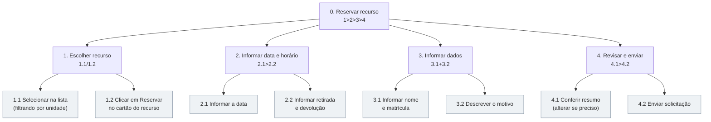

# 🧩 Análise e modelagem de tarefas (Aula 9)

## Tarefa analisada: Reservar recurso audiovisual

### HTA (Análise Hierárquica de Tarefas)

Notação dos planos: `1>2` sequencial · `1/2` seleção · `1+2` paralelo. Operações (folhas) estão com fundo cinza.



**Como a HTA virou interface:** o plano `1>2>3>4` virou as 4 etapas do formulário (`src/pages/NovaReserva`). A seleção `1.1/1.2` virou dois caminhos: escolher na etapa 1 ou clicar em **Reservar** no cartão do recurso, que já pula para a etapa 2.

### GOMS: objetivo 1 “Escolher recurso”

```
GOAL 0: reservar recurso audiovisual
  GOAL 1: escolher o recurso
    METHOD 1.A: escolher no formulário de reserva
      (SEL. RULE: o usuário sabe a unidade, mas não o equipamento exato)
      OP. 1.A.1: abrir “Reservar” no menu
      OP. 1.A.2: selecionar a unidade no filtro
      OP. 1.A.3: examinar a lista de recursos
      OP. 1.A.4: clicar no recurso desejado
      OP. 1.A.5: clicar em “Continuar”
    METHOD 1.B: buscar na página Recursos
      (SEL. RULE: o usuário sabe o nome ou o tipo do equipamento)
      OP. 1.B.1: abrir “Recursos” no menu
      OP. 1.B.2: digitar o nome no campo Buscar
      OP. 1.B.3: verificar os resultados
      OP. 1.B.4: clicar em “Reservar” no cartão
  GOAL 2: informar data e horário
    OP. 2.1: verificar a data sugerida (hoje)
    OP. 2.2: alterar a data, se necessário
    OP. 2.3: ajustar retirada e devolução
    OP. 2.4: clicar em “Continuar”
  ...
```

**Decisões tiradas do GOMS:** o método 1.B pula a etapa 1 inteira (menos operadores); os padrões de data e horário eliminam operadores no caso mais comum (aula noturna de hoje).

## Tarefa analisada: Confirmar reserva (setor audiovisual)

```
GOAL 0: decidir sobre um pedido
  GOAL 1: localizar o pedido
    OP. 1.1: abrir “Confirmar reservas” (já abre em Pendentes)
  GOAL 2: decidir
    METHOD 2.A: decidir pela lista
      (SEL. RULE: o motivo na lista é suficiente)
      OP. 2.A.1: ler aluno, recurso, data e motivo
      OP. 2.A.2: clicar em Confirmar  ou  Rejeitar > confirmar no diálogo
    METHOD 2.B: abrir os detalhes
      (SEL. RULE: precisa de mais informação ou imprimir)
      OP. 2.B.1: clicar em “Ver detalhes”
      OP. 2.B.2: ler / imprimir
      OP. 2.B.3: clicar em “Voltar para a lista”
  GOAL 3: corrigir engano (opcional)
    OP. 3.1: clicar em “Desfazer” no aviso
```
